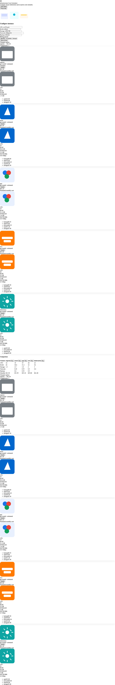

Infra Cost Calculator (Local)

Backend: Flask (port 5000)
Frontend: Next.js + Tailwind (port 3000)

Run backend first, then frontend.

## Backend - Development & Tests 🔧

1. Install runtime dependencies (from project root):

```bash
cd backend
python3 -m pip install -r requirements.txt
```

2. (Optional) Install dev/test dependencies:

```bash
python3 -m pip install -r requirements-dev.txt
```

3. Run the server locally:

```bash
python3 app.py
# or: FLASK_APP=app FLASK_ENV=development flask run --port=5000
```

4. Run tests:

```bash
python3 -m pytest -q
```

Notes:

## v2.3 Calculation Contract

- `cpu` is vCPU per instance; `ram` is GB RAM per instance.
- `instance_count` scales compute resources and instance charges.
- `storage` and `backup` are GB totals for the whole scenario, billed monthly.
- `network_ingress_gb_month` and `network_egress_gb_month` are scenario-wide monthly GB. Ingress is currently modeled as free; egress uses the configured estimate per GB.
- Legacy requests using `network` are still accepted as Mbps and converted using the existing 324 GB/month per Mbps assumption. New clients should send the explicit ingress/egress fields.
- Catalog and infrastructure prices are static estimates. `/api/catalog` and `/api/calculate` return `price_provenance`; regional scope and refresh time are currently unverified for the cloud catalogs.
- Requests that exceed catalog capacity or select an undersized SKU return HTTP 422 rather than a misleading smaller-instance estimate.

## v3.0 Network Pricing Slice

- Monthly internet egress uses FRD tier estimates per provider: first 10,000 GB, next 40,000 GB, then traffic above 50,000 GB. One TB is modeled as 1,000 GB.
- Ingress is returned as an explicit zero-cost line item.
- Cross-region transfer is a separate monthly GB input and requires distinct source and destination region labels. Reference rates are AWS $0.02/GB, Azure $0.02/GB, and GCP $0.01/GB; the generic Kubernetes and on-prem baselines use their existing network rates.
- These are roadmap reference rates, not live region-pair quotes. Cloud catalog pricing remains static and is not yet resolved by the selected source/destination regions.

## v3.0 Database Price Catalog

The database price sync normalizes published provider price records into a local cache for AWS RDS/Aurora, DynamoDB, and Redshift; Azure SQL, PostgreSQL, Cosmos DB, and Synapse; and GCP Cloud SQL, Spanner, Firestore, Bigtable, and BigQuery.

1. Enable the Google Cloud Billing Catalog API and configure `GOOGLE_CLOUD_BILLING_API_KEY` in the local backend environment. Do not commit the key.
2. From `backend/`, refresh the price cache for the chosen regions:

```bash
python3 -m utils.database_price_sync --aws-region us-east-1 --azure-region eastus --gcp-region us-central1
```

3. The sync writes `backend/cache/database_prices.json`. AWS and Azure price sources are public; if GCP is unavailable or its key is missing, the cache records the provider status and keeps other provider prices usable.
4. `GET /api/database/catalog?provider=aws&service=rds&region=us-east-1` returns matching source rates. `POST /api/database/calculate` accepts selected rate IDs and quantities in the exact units returned by the price APIs.

Database estimates include only selected rate lines; they do not infer workload quantities or silently invent missing prices. Always review the source, effective date, unit, region, and provider sync status shown with the estimate.

## Search and Social Discovery

- The site uses `https://www.infracostiq.com/` as its canonical URL and serves `/robots.txt`, `/sitemap.xml`, `/opengraph-image`, and `/indexnow-key.txt`.
- To verify Google Search Console, create a **Domain** property, add Google's TXT record in GoDaddy DNS, and wait for DNS propagation. Optionally set `GOOGLE_SITE_VERIFICATION` to the HTML-tag token before building the frontend.
- To verify Bing Webmaster Tools, import the verified Google Search Console property or use Bing's DNS verification record in GoDaddy. Optionally set `BING_SITE_VERIFICATION` to Bing's HTML-tag token before building the frontend.
- Submit `https://www.infracostiq.com/sitemap.xml` in both consoles. After deployment, inspect the homepage and check indexing/coverage reports; sitemap submission is a discovery hint, not an indexing guarantee.
- IndexNow uses the public key file at `/indexnow-key.txt`. To notify IndexNow after publishing, set `INDEXNOW_URLS` to a comma-separated list of fully qualified URLs and run `npm run indexnow:submit` from `frontend/`. The command is opt-in and does not run during builds.
- Keep `www.infracostiq.com` as the single canonical host. Configure a permanent redirect from the apex `infracostiq.com` to `www.infracostiq.com` at the hosting layer if both hosts resolve.

## Frontend - Development & Local Testing 🖥️

1. Configure the API URL (optional - defaults to http://127.0.0.1:5000):

```bash
# Copy the example and edit if needed
cp frontend/.env.local.example frontend/.env.local
```

2. Install dependencies and run the dev server:

```bash
cd frontend
npm install
npm run dev -p 3000
# open http://localhost:3000
```

3. Manual test (UI):

Screenshot (desktop):



## E2E tests (Playwright)

1. Install Playwright dev dependency and browsers:

```bash
cd frontend
npm install
npx playwright install
```

2. Start the dev server (in one terminal):

```bash
npm run dev -p 3000
```

3. Run E2E tests (in another terminal):

```bash
npm run test:e2e
```

The E2E verifies Azure and GCP totals are displayed and non-zero using a headless Chromium instance.


---

## AWS MVP: instance-based pricing (new)

This project includes an MVP for AWS instance-based pricing:

- A compact instance catalog is available at `backend/data/aws_catalog.json` with representative SKUs and on-demand hourly prices (placeholders).
- The backend implements a simple matcher (`backend/utils/aws_catalog.py`) that selects the nearest instance SKU for a CPU/RAM request and computes the monthly instance cost using SKU hourly price.
- `backend/cloud_providers/aws.py` uses the matcher and returns `selected_instance` metadata in the `/calculate` response (fields: sku, count, price_per_hour, price_per_month).

Notes & next steps:

- The MVP uses a small in-repo catalog. For production-grade accuracy, we recommend adding a price-sync job that fetches real catalog data from AWS Pricing API and updates per-SKU `price_per_hour` values.
- After AWS is working, the same approach can be applied to Azure and GCP.
 
### Running the AWS price sync

You can sync on-demand hourly prices from AWS using either the public EC2 offerings (no credentials required) or the AWS Pricing API.

**Option 1: Public EC2 Offerings (Recommended — no credentials required)**

```bash
cd backend
python -m utils.aws_price_sync --public --write-catalog
```

This downloads the public EC2 offerings JSON file (shared tenancy, Linux, on-demand pricing for the specified region) and extracts prices for your catalog SKUs. It writes a cache at `backend/cache/aws_prices.json` and with `--write-catalog` updates the `price_per_hour` values in `backend/data/aws_catalog.json`.

**Option 2: AWS Pricing API (requires AWS credentials)**

```bash
cd backend
python -m utils.aws_price_sync --write-catalog
```

This uses boto3 to query the AWS Pricing API (requires AWS credentials and IAM permissions for pricing:GetProducts). Results are cached and optionally written to the catalog.

**Common options**

- `--location`: Specify an AWS region (default: 'US East (N. Virginia)'). Examples:
  - 'US East (N. Virginia)'
  - 'US West (Oregon)'
  - 'EU (Ireland)'
  - etc.

Example with custom location:

```bash
python -m utils.aws_price_sync --public --write-catalog --location "EU (Ireland)"
```

## CI status

The project runs unit tests and E2E tests on PRs via GitHub Actions. Add a status badge after you push the repo to GitHub (replace <OWNER> and <REPO>):


How to update badge for your repo:

1. Replace `<OWNER>` and `<REPO>` in the badge URL above with your GitHub username/organization and repository name.
2. After pushing to GitHub, visit the Actions tab → `backend-ci` to view logs for any failed jobs.

Tip: If you want, tell me your GitHub `owner/repo` and I’ll add the badge for you.
Hlo this side sumit now we are testing ci cd automation
we are testing ci cd automation again
hi myself sumit and my client is Mr. Srinath


